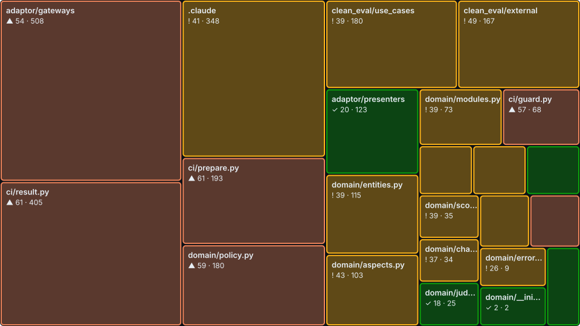

# clean-eval
Flexible, scalable, and explainable verification framework for agentic development to follow clean architecture best practices.

## Skills

Claude Code skills in `.claude/skills/` form a feedback loop:

| Skill | What it does | Reads / writes |
|---|---|---|
| `/risk-heat-map` | Rates every module on four aspects (Business Impact, Side Effects & Reversibility, Entropy, Unverified) from static analysis plus a levelling read-through, and draws the treemap in the section below. | code → README + `docs/risk-heatmap.svg` |
| `/pr-review [PR#\|branch]` | Reviews a change against `pr-review/review-rules.md`, with depth scaled by the most severe band it touches in the heat map of its base. Every finding cites a rule ID. | heat map + rules → review |
| `/eval [period]` | Replays merged PRs in a period, links later fixes/reverts to the PRs that caused them, measures how well risk scores and rules predicted them, and recommends changes to weights, thresholds and rules. | history → advice for model + rules |

Requires [uv](https://docs.astral.sh/uv/) (it provides Python 3.15 and the locked dependencies, pydantic and click among them) and
git; `gh` (authenticated) for PR-number reviews, posting, and rule metrics in `/eval`.
Optional: the `code-review-graph` CLI, for call and execution-flow data in the heat map (`--graph code-review-graph`).

### Code layout

The skills hold only instructions; the logic is the `clean_eval/` package, in Clean Architecture layers whose
dependencies point inward. The GitHub Action is the same package behind one entry script, `action.sh`:

| Layer | Holds | May import |
|---|---|---|
| `clean_eval/domain/` | data models only: pydantic models of the policy, the source read, the ratings and heat map, a change's risk, reviews, merged-PR history and an eval's outcome. Every invariant is a validator: score ranges, the policy's knobs, an agent finding's rule, severity and line, commit ids, step outputs | pure stdlib modules and pydantic |
| `clean_eval/use_cases/` | two things. `interfaces.py`: the abstract classes of every external utility the business logic uses (`Git`, `CodeHost`, `FileSystem`, `KnowledgeGraph`, `Environment`, `Clock`, `DiagramPresenter`, `ReportPresenter`). Everything else: module-level functions that take implementations of those interfaces as parameters and call only their abstract methods. These are the use cases (rate a repository, assess a change, refresh the README section, collect history; for CI: prepare the agent's context, finalize its output, post the review), what they share (sources, run files, the `.clean-eval/` snapshot), and `rules/`: the business rules as pure functions over the models (the four aspects, scoring, judgement, review, redaction, calibration, tuning, the built-in knowledge graph) | `domain`, the same |
| `clean_eval/adaptor/` | the presenters (SVG treemap, Markdown summary), implementing `DiagramPresenter` and `ReportPresenter`; rendering only, never I/O | `domain`, `use_cases` |
| `clean_eval/external/` | everything that touches the outside world: one gateway class per external dependency, each implementing its interface (`GitGateway`, `GitHubGateway`, `CodeReviewGraphGateway`, `FileSystemGateway`, `EnvironmentGateway`, `ClockGateway`), the command line (with the CI commands and the agent's guard hook) and the composition root that hands the gateways and presenters to the use cases | everything |

`tests/test_architecture.py` enforces the layering (every import absolute, never relative), the purity of the two inner
layers (no I/O, no clock), that the domain holds only data models (no functions; model methods are validators, computed
fields, properties or constructors), that the use cases hold only the interfaces (abstract classes whose methods are all
abstract) and module-level functions, that each interface has one implementation exposing nothing beyond it, and that
each external dependency is reached only through its gateway (no other module may import `subprocess`, `sqlite3`, `os`,
`shutil`, `filecmp` or `pathlib`, open a file, read the clock or the environment; the console belongs to the command
line).

Run it as `uv run python -I clean_eval <rate|readme|report|assess|history> ...` from this checkout; from another
repository, `uv run --frozen --no-config --project <clean-eval> python -I <clean-eval>/clean_eval ...`. `-I` keeps the
rated repository off `sys.path`, so none of its code can be imported, and `--no-config` keeps its uv settings out.
`action.sh` also runs `prepare`, `finalize`, `post`, `redact` and `guard`.

### Per-repo configuration

Each repo can keep its own tuning in `.clean-eval/` — these take precedence over the bundled defaults, and
`/eval` writes its applied recommendations there:

- `.clean-eval/risk-model.json` — overrides of the risk policy (weights, saturations, standards, module splitting);
  contract in `.claude/skills/risk-heat-map/references/rate.md`
- `.clean-eval/review-rules.md` — layers, tier policy, rules

## GitHub Actions

Use the skills from any repo's workflow via the composite action in this repo:

```yaml
- uses: actions/checkout@v4
  with:
    fetch-depth: 0                 # required: risk scoring reads git history
    persist-credentials: false     # recommended: keep the token out of .git/config
- uses: RainrainWu/clean-eval@v1
  with:
    skill: pr-review               # risk-heat-map | pr-review | eval
    anthropic-api-key: ${{ secrets.ANTHROPIC_API_KEY }}
```

| Skill | Needs Claude credentials | Key inputs | Outputs |
|---|---|---|---|
| `risk-heat-map` | no (static scores; `use-claude: true` adds the levelling read-through) | `readme`, `diagram` | `readme-changed`, `result` |
| `pr-review` | yes | `pr` (defaults to the triggering PR), `post`, `fail-on: never\|request_changes\|blocker` | `verdict`, `max-tier`, `blockers`, `result` |
| `eval` | yes | `since`, `until`, `apply` | `auc`, `result` |

Common inputs: `model`, `max-turns`, `claude-code-version`, `extra-prompt`, `working-directory`, `github-token`.
Every run writes `report.md`, `result.json` and `claude.log` to `outputs.output-dir` and a job summary.
The action never commits — pair it with a create-PR step. Ready-to-copy workflows: [`examples/workflows/`](examples/workflows).

**Versions:** `@v1` follows the latest 1.x [release](https://github.com/RainrainWu/clean-eval/releases), so fixes and
features arrive without breaking changes. To change versions only on purpose, pin a release (`@v1.2.0`) or, safest,
its commit SHA (`@<sha> # v1.2.0`).

- **Credentials:** `anthropic-api-key` or `claude-code-oauth-token`; for Bedrock/Vertex set
  `CLAUDE_CODE_USE_BEDROCK=1` / `CLAUDE_CODE_USE_VERTEX=1` and cloud credentials in the step's `env`.
- **Permissions:** `pull-requests: write` to post reviews; `contents: read` otherwise.
- **Forks:** trigger reviews on `pull_request`, never `pull_request_target`, and skip fork/Dependabot PRs
  (they get no secrets) — see the example workflow.

### Trust model

The agent reads untrusted text (PR diffs and descriptions, commit messages, comments), so in CI it only
*proposes*; deterministic code decides and acts:

1. **Precompute** (`clean_eval prepare`): the PR diff, per-file history, the change's risk from the heat map of its
   base commit, and the `.clean-eval/` config **from the base commit** (a PR can't relax the rules it's judged by);
   for `eval`, the history (every PR rated against its base), defect patches and one-knob sensitivity replays.
2. **Sandboxed agent** (`action.sh`): `claude --restricted --strict-mcp-config` — no shell, no web, no MCP, and
   no user/project settings or hooks from the checkout — with a scrubbed environment (no `GH_TOKEN` or runner
   tokens) and stdin from `/dev/null`. It takes no instructions from the checkout either: no `CLAUDE.md`,
   `AGENTS.md` or `.claude/rules/`, and no skills, which a PR could otherwise edit to steer its own review.
   Restricted mode skips them (verified with Claude Code 2.1.328), and the agent's settings exclude them explicitly
   (`CLAUDE_CODE_DISABLE_CLAUDE_MDS`, `claudeMdExcludes`, the AGENTS.md setting, and a deny rule for the Skill tool,
   which the guard denies too). File tools are confined to the checkout and the precomputed context
   (read) and the agent's output folder (write; plus `.clean-eval/` for `eval` with `apply: true`), enforced
   both by Claude Code and independently by a PreToolUse hook (`clean_eval guard`) that resolves real paths, so
   symlinks and `.git/` are off-limits; a hook that fails for any reason denies. The checkout is untrusted too:
   clean-eval's environment is installed from its own `uv.lock` (hash-checked, `--no-config`, outside every checkout),
   and every Python call runs isolated (`python -I`), so a module a PR adds (say a `json.py` or `pydantic.py`) can't
   shadow the standard library or a dependency.
3. **Finalize** (`clean_eval finalize`): validates the agent's output, turns unknown rule IDs into `NEW`, raises each
   finding to at least its rule's severity, and derives the verdict, blocker count and tier itself. Secrets
   (values of secret-looking env vars and known token formats) are redacted from everything that leaves the
   runner; step outputs carry only enums and numbers. `eval` edits to `.clean-eval/` are kept only if they
   touch tunable keys and don't lower AUC on replay; anything else under `.clean-eval/` is restored.
4. **Post** (`clean_eval post`): one review with inline comments; earlier "changes requested" reviews from the
   action are dismissed so a fixed PR isn't left blocked.

## Development

```bash
uv sync                                                # Python 3.15 and the locked dependencies, in .venv
uv run pytest                                          # every test: fake gh/claude, no network
uv run pytest -m "not e2e"                             # skip the subprocess end-to-end tests (seconds, not ~30 s)
uv run pytest tests/use_cases/test_heatmap.py          # one module (::TestRate for one class, -k to filter)
uv run ruff check --fix .                              # lint: pycodestyle, pyflakes, isort's import order
uv run ruff format .                                   # format: Black's style, 120 columns
uv run ty check                                        # type check (every function of the package is annotated)
```

The tests are written for pytest and laid out like the package: `tests/<layer>/` holds the tests of
`clean_eval/<layer>/` (`test_<module>.py` for `<module>.py`) and follows the same dependency rule. Tests are grouped in
classes. Their fixtures live in the `conftest.py` at the level of the tests that share them, and a test customises a
fixture through `request.param` (indirect parametrization). External dependencies are MagicMocks injected into the code
under test; the use cases' git and file system answer through in-memory fakes that run through the same contract
checks as the real gateways. The tests at the top of `tests/` span the layers: the architecture and code-style rules,
`action.sh` end to end, and the release check. The `tests` workflow runs the suite, both ruff checks and ty's type check
on every push to a pull request and to `master`.

Coding agents: `AGENTS.md` at the root and in each layer folder (and `tests/`) holds the commands and the rules that
apply there; each folder's `CLAUDE.md` imports its `AGENTS.md` for Claude Code.

### Releasing

Releases are [semver](https://semver.org) tags on `master`, `vMAJOR.MINOR.PATCH`: MAJOR when the action's inputs or
outputs, the `.clean-eval/` files or the command line change incompatibly, MINOR for backward-compatible features,
PATCH for fixes.

1. In a PR, bump the version with `uv version --bump minor` (or `major`, `patch`; `uv version 1.3.0-rc.1` for a
   pre-release). It updates `pyproject.toml` and `uv.lock`.
2. Once it is merged, tag the merge commit and push the tag: `git tag v1.3.0 <merge commit> && git push origin v1.3.0`.
3. The `release` workflow checks the tag ([`.github/scripts/check_release.py`](.github/scripts/check_release.py):
   semver, on `master`, equal to the version in `pyproject.toml`, newer than every release), runs the tests at it,
   publishes the GitHub Release with generated notes and moves the major tag (`v1`) to it. A pre-release
   (`-alpha.N`, `-beta.N`, `-rc.N`) is published as one and leaves `v1` alone.

If a check fails, nothing is published: delete the tag (`git push origin :refs/tags/v1.3.0`), fix, and tag again.

## Risk Heat Map

<!-- risk-heat-map:start -->
<!-- risk-heat-map:fingerprint=801b34699227 -->



Tile area is module size (lines of code, tests excluded); colour is the overall risk of changing it. Heuristics from static analysis of `chore/readme-only-heat-map` at `ee84f6c` (2026-11-22), not a verdict. Regenerate with the `risk-heat-map` skill.

🟢 Low 0-24 · 🟡 Moderate 25-49 · 🟠 High 50-74 · 🔴 Critical 75-100
<!-- risk-heat-map:end -->

